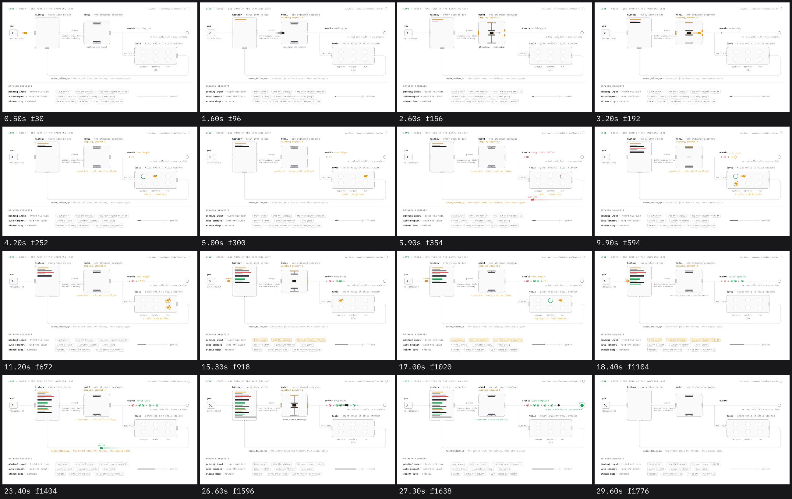
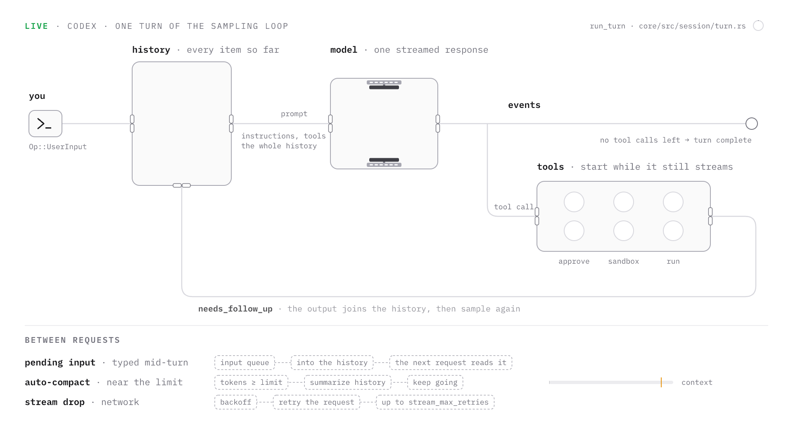
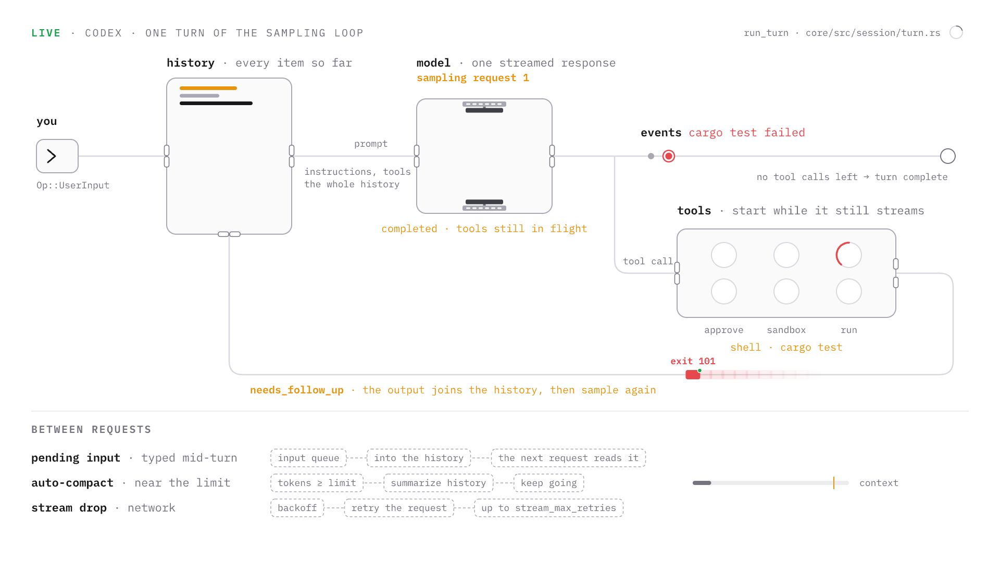
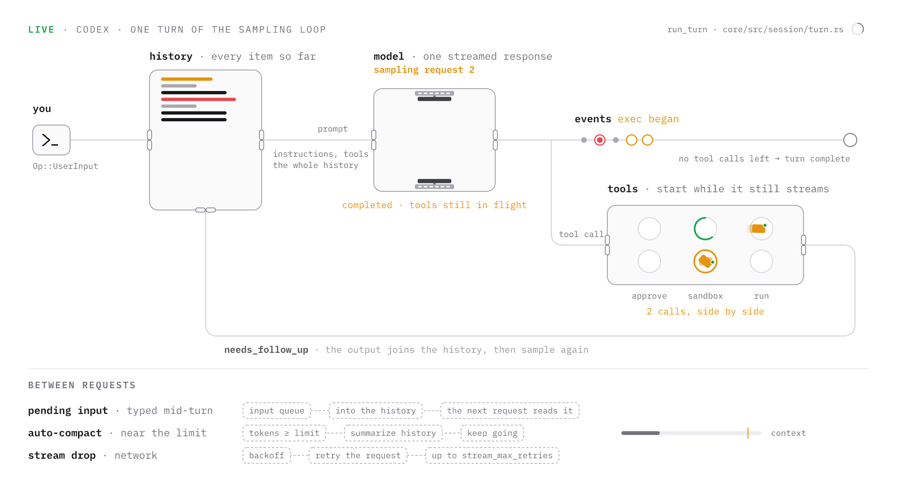
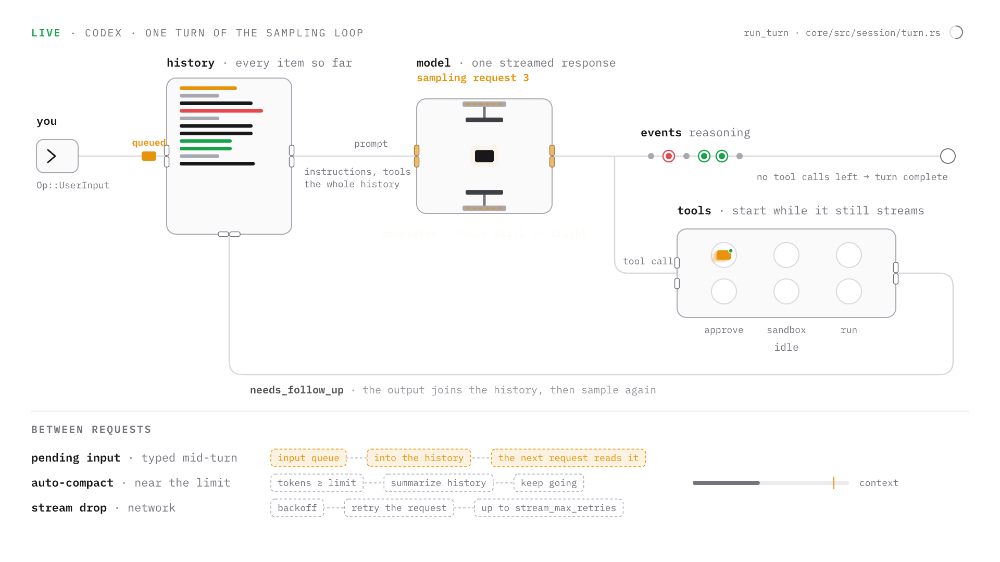
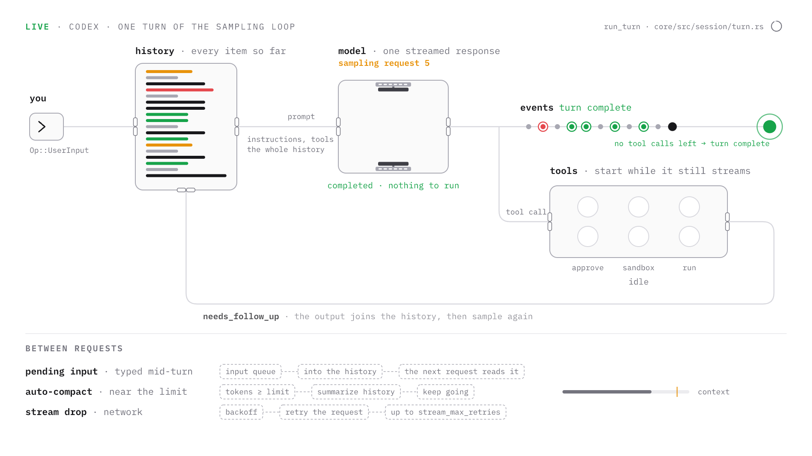

# Machine diagrams with fframes

One kind of video: a looping diagram where a system is machines on rails and its behaviour is
cards moving through them. This is what the accepted result looks like, sixteen moments of
one 29.9 s loop:



Use this skill together with `fframes-video` (install, command line, general API). This file
is the specification of this video and the procedure to make another one like it.

**The rule that keeps quality from drifting: copy, do not re-create.** `template/` is the
accepted video (1338 lines of `lib.rs`, `main.rs`, two font files). `images/` are its frames.
A new diagram starts as a copy of the template and is changed step by step, and after every
step its frames are compared with the frames in `images/`. Never write this kind of video
from an empty file, and never "improve" a number in `references/motion.md` without a strip
that shows the reason.

Files:

| file | what it is |
| --- | --- |
| `template/lib.rs`, `template/main.rs`, `template/media/*.ttf` | the accepted video, compiles as is |
| `images/frame-*.png` | five full frames, the layout reference |
| `images/story.png` | the sheet above |
| `images/strip-*.png` | consecutive frames of every mechanism, the motion reference |
| `references/motion.md` | every motion number, with the strip that shows it |
| `references/timeline.md` | the exact schedule of the loop, second by second |

## The picture

1920 x 1080, 60 fps, white. The empty diagram (frame 0, and again at the end of the loop):



Read it left to right:

- **you**: a box with a prompt mark and a blinking caret. Cards with your input leave it.
- **history**: a tall box that fills with one bar per recorded item. Three gates: input on the
  left, prompt out on the right, tool outputs in at the bottom.
- **model**: a press. The prompt card is clamped in it while the response streams. Above it
  the request counter, under it the status line of the stream.
- **events**: the rail to the right. Every event to the UI becomes a dot; it ends in a
  terminal that fills when the turn is complete.
- **tools**: reached by a branch down from the main rail. Two lanes of three slots: approve,
  sandbox, run. Under it its status line.
- **return rail**: from the tools exit down, left along the bottom and up into the history.
  Its label is the name of the loop condition.
- **between requests**: three rows of dashed chips for what only sometimes happens, and a bar
  for how full the context is.

Four more frames fix the look of the states. Compare your frames with these at full size.

A failed tool output on its way back (5.9 s). The card is red and carries "exit 101", the
ring of the "run" slot unwinds, the return label is amber, the events line says what happened
in red:



Two tool calls of one response at once (10.6 s). Two lanes, each card in a different stage,
the model already released ("completed · tools still in flight"), two amber rings on the
event rail:



A message typed mid-turn (15.3 s). It waits outside the history gate with "queued" above it,
its row in the band below is lit, and meanwhile the press holds the prompt of request 3 and a
call has landed in "approve":



The end (27.3 s). The terminal is green with one ring leaving it, the events line and the
sentence under the rail are green, the model says "completed · nothing to run", tools are
idle, the history is full:



### Fixed values

Do not change these when adapting; they were tuned on the frames above.

| thing | value |
| --- | --- |
| font | IBM Plex Mono, weights 400 and 600 only. Every glyph advances 0.6 em: the x of text after other text is computed (`fn label`), not measured |
| station label | 22 px, name weight 600 in ink, description weight 400 in dim, one line, above the box |
| section header | 20 px, weight 600, letter-spacing 2.5, upper case |
| status line | 20 px centered under its machine; 22 px next to "events" |
| captions, chips, stage names, riding tags | 18 px. Nothing on screen is smaller |
| machine box | fill `#fafafa`, stroke `#a8a8b2` 2 px, corner radius 18 |
| rail | `#d8d8de`, 2.5 px, corners of radius 26 |
| card | 28 x 18 px (prompt 36 x 23, reasoning 18 x 11.5), corner radius 4 |
| slot | circle radius 24, fill white, stroke `#d8d8de` 2 px; lanes 70 px apart, stages 120 px apart |
| gate | two halves of 9 x 20 px, centers 11 px from the rail closed, 24 px open |
| history bar | 7 px high, 14.5 px pitch, from x 345, y 166; width by kind: user 110, reasoning 76, call 140, output 100 (ok) or 160 (failed), message 190 |
| event dot | 34 px apart from x 1250; reasoning radius 6, call ring radius 11 with a radius 6 center, message radius 10 |
| margins | 60 px left and right; the band below starts at the divider y 790 |

Coordinates of the stations (centers): history (440, 300) 240 x 300; model (930, 300)
260 x 220; tools (1510, 525) 420 x 170; you 80 x 64 at x 70, y 268; main rail y 300; branch
x 1180; return rail x 1830 and y 720; terminal x 1820; slots x 1390, 1510, 1630 and y 490,
560.

Palette. Color means state and nothing else:

| role | color |
| --- | --- |
| background | `#ffffff` |
| machine fill | `#fafafa` |
| divider, empty bar | `#ececef` |
| rail, idle slot | `#d8d8de` |
| machine edge, reasoning | `#a8a8b2` |
| secondary text, gate stroke | `#74747e` |
| press plates, sparks | `#3f3f46` |
| text, prompt card, tool call bar, message | `#18181b` |
| working, waiting, in flight, your input | `#e8930c` |
| ended well | `#17a34a` |
| ended badly | `#e5484d` |

No fourth accent, no gradients, no shadows. If a dark version is asked for, swap only these
constants: `#0a0a0b` background, `#0e0e10` machine fill, `#242428` divider, `#3a3a3f` rail,
`#56565c` edge, `#8b8b91` secondary text, `#c9c9ce` plates, `#ededee` text, `#f2b866` amber,
`#7ed6a0` green, `#f07c6c` red.

## The story of the template

One loop is one concrete turn, chosen so that every mechanism is used. It is the table
`TURN` in `template/lib.rs` plus `INTERRUPTED = 2`:

| request | starts | the model asks for | what it shows |
| --- | --- | --- | --- |
| 1 | 1.3 s | `shell · cargo test`, fails with `exit 101` | a red output; the loop goes on after a failure |
| 2 | 7.1 s | two shell calls in one response (`3 matches`, `41 lines`) | two lanes at once |
| 3 | 12.9 s | `apply_patch`, 0.9 s in "approve" (`patched`) | approval; at 13.9 s you type a message, it queues and enters at 18.25 s |
| 4 | 18.7 s | `shell · cargo test`, passes with `exit 0` | a green output |
| 5 | 24.5 s | a message, no tool call | the loop ends at 27.0 s |

After 27.0 s: 2 s hold, everything the turn drew leaves in 0.5 s from 29.0 s, the loop point is
at 29.9 s. `references/timeline.md` has every event with its second.

Every loop needs these six things; when writing a story for another system, name which
request shows each: a failure, a success, a wait, a parallel moment, a queue, an ending.

## The procedure for a new diagram

Do the steps in order. Each ends with a check; do not go on until it passes.

### 1. Learn the system from its source

The diagram must be true. Find the code that implements the loop and read it; do not rely on
memory. For the template the facts came from `codex-rs/core/src/session/turn.rs` in
`openai/codex` (`run_turn`, `run_sampling_request`, `try_run_sampling_request`,
`drain_in_flight`):

```bash
mkdir -p /tmp/src && cd /tmp/src
curl -fsSL -o turn.rs https://raw.githubusercontent.com/openai/codex/main/codex-rs/core/src/session/turn.rs
grep -nE "fn (run_turn|run_sampling_request|try_run_sampling_request|drain_in_flight)|needs_follow_up|ResponseEvent::[A-Za-z]+|get_pending_input|FuturesOrdered|stream_max_retries|auto_compact" turn.rs
```

File paths move (`core/src/codex.rs` no longer exists). When one is missing, search for the
function name instead of guessing.

Write this list before any layout:

| question | the template's answer |
| --- | --- |
| stations: where does data rest or get processed? | history, model, tools, UI |
| cards: what moves between them? | input, prompt, reasoning item, tool call, tool output, message |
| stages of one cycle, in the code's words | `created`, deltas, `item.done`, `completed` |
| what runs in parallel? | tool calls start at `item.done` while the stream goes on (`in_flight`) |
| what closes the loop? | outputs are recorded, `needs_follow_up` is true |
| what ends it? | a response without a tool call and no pending input |
| what happens only sometimes, between cycles? | pending input, auto-compact, stream retry |

Check: every label planned for the screen is a name from the source or a plain description of
something read in it. Commands and results in the story (`cargo test`, `exit 101`) are
examples; say so in the final message.

### 2. Copy the template

In the fframes repository:

```bash
just new my-diagram
S=~/.agents/skills/fframes-machine-diagram/template
cp $S/lib.rs $S/main.rs examples/my-diagram/src/
rm examples/my-diagram/media/*.ttf && cp $S/media/*.ttf examples/my-diagram/media/
sed -i 's/CodexLoop/MyDiagram/g; s/codex_loop/my_diagram/g; s#examples/codex-loop/media#examples/my-diagram/media#' examples/my-diagram/src/*.rs
cargo build --release -p my-diagram          # in the background, the first build is slow
```

Outside the repository: `cargo fframes new my-diagram --yes`, the same copies, and the media
path is `"media"`.

Check: `cargo run --release -p my-diagram -- inspect` prints "no problems found", and
`frame 10.6s` is the same picture as `images/frame-10.6s-two-calls.png`. Only now start
changing things.

### 3. Rename, then re-story, then re-shape

Change in this order and render the five reference frames after each of the three:

1. **Labels only.** Static labels are all in `fn backdrop`; changing ones are the `Notes`
   pushed in `new` (`model_notes`, `event_notes`, `tool_notes`) and the header in
   `render_frame`. Keep each to the length of the text it replaces: width is
   `characters * 0.6 * size`, and the neighbours are close.
2. **The story.** Rewrite `TURN` and `INTERRUPTED`. A change of story is a change of this
   table and of nothing in `render_frame`.
3. **The shape**, only if the system needs it. Keep the skeleton: source on the left, what
   accumulates next, what computes in the middle, side work on a branch below, the result on
   the right, the return rail along the bottom. A new station is a `machine(...)` in
   `backdrop`, its gates in the `gates` array in `new` (and a `GATE_*` constant), routes
   through it and one of the mechanisms below. A third parallel lane is a third entry in
   `LANES_Y` and a taller tools box.

Every station must have a mechanism. A box with only a label is not allowed.

| mechanism | code | when to use it | strip |
| --- | --- | --- | --- |
| gate | `Gate`, `fn gate`, registered by `fn leg` | every wall a card crosses | `strip-input.png` |
| press | `Sampling`, `fn press` | one long operation on one card, with up to six named stages | `strip-press-close.png`, `strip-press-open.png` |
| slots | `Stay`, `fn slot` | staged work, parallel work in lanes | `strip-calls-into-slots.png`, `strip-slot-ends-output-leaves.png` |
| stack | `Row` | something that accumulates | `strip-output-into-history.png` |
| event rail | `Dot` | a log of what happened | `strip-ending.png` |
| queue | a `Card` with two legs and a `tag` | waiting outside a gate | `strip-queue-drains.png` |
| status line | `Notes`, `fn note` | the name of the current stage | `strip-press-close.png` (under the machine) |

### 4. Time it

The schedule is constants in seconds from the start of a cycle and one `PERIOD`:

| constant | value | meaning |
| --- | --- | --- |
| `PERIOD` | 5.8 | between the starts of two cycles. Below 5 the status lines cannot be read, above 6.5 it drags |
| `PROMPT_SENT` | 0.55 | the prompt card reaches the model and the press closes |
| `CREATED`, `REASONING`, `REASONING_DONE`, `ITEM_STARTS`, `ITEM_DONE` | 0.62, 0.72, 1.2, 1.3, 1.8 | the stream stages, one light each |
| `NEXT_CALL` | 0.25 | a second call of the same response follows this much later, and everything of it is this much later |
| `COMPLETED` | 2.3 | the press opens (plus `NEXT_CALL` per extra call) |
| `CALL_LANDS` | 0.6 | from the model into the first slot |
| `HOP` | 0.3 | between two slots |
| `TOOL_DONE` | 4.3 | the last stage ends and the output leaves |
| `OUTPUT_TRAVELS` | 0.9 | the return rail |
| `TURN_COMPLETE` | 2.5 | the final message reaches the terminal |

Check the arithmetic for every call: `ITEM_DONE + CALL_LANDS + approval + HOP + 0.3 + HOP`
must be less than `TOOL_DONE` (with the 0.9 s approval it is 4.2 against 4.3). A stage with a
negative length draws nothing and reports nothing. The last output must be recorded at least
0.3 s before the next cycle starts (5.45 against 5.8 with two calls).

### 5. Review consecutive frames

Stills cannot judge this video. After `inspect` is clean, render the same strips as in
`images/` from the new video and put them next to the originals. From the example's folder,
with `B=../../target/release/my-diagram`:

```bash
seq() { python3 -c "print(','.join(f'{$1+i*$2:.3f}s' for i in range($3)))"; }
$B frame 0s,5.9s,10.6s,15.3s,27.3s -o frames
$B strip 0.5s,1.6s,2.6s,3.2s,4.2s,5.0s,5.9s,9.9s,11.2s,15.3s,17.0s,18.4s,23.4s,26.6s,27.3s,29.6s --columns 4 --width 640 -o story.png
$B strip $(seq 0.30 0.05 12)  --columns 4 --width 480 --crop 40,200,560,200    -o strip-input.png
$B strip $(seq 7.10 0.05 18)  --columns 3 --width 640 --crop 540,150,560,330   -o strip-press-close.png
$B strip $(seq 9.30 0.05 12)  --columns 3 --width 640 --crop 540,150,560,330   -o strip-press-open.png
$B strip $(seq 8.85 0.07 18)  --columns 3 --width 640 --crop 1020,220,740,420  -o strip-calls-into-slots.png
$B strip $(seq 5.40 0.06 18)  --columns 3 --width 640 --crop 1240,400,640,360  -o strip-slot-ends-output-leaves.png
$B strip $(seq 6.20 0.05 12)  --columns 4 --width 480 --crop 280,380,480,400   -o strip-output-into-history.png
$B strip $(seq 18.10 0.05 12) --columns 4 --width 480 --crop 40,200,560,200    -o strip-queue-drains.png
$B strip $(seq 26.30 0.08 15) --columns 3 --width 640 --crop 1160,200,720,180  -o strip-ending.png
```

Those are the commands that made `images/`. When the story or timing changed, move the start
times to the same events of the new schedule. Open every sheet and check it against the list
in `references/motion.md` ("What each strip must show"). Then:

- frame 0 and the last frame are the same empty diagram, except the corner clock and the
  caret (a status line that kept its last text over the loop point was a real bug here);
- no text touches a box, a gate or other text in any of the five frames;
- `inspect --pops` warnings are only fast cards on the return rail and status lines that
  swap. Open two of the crops it names to be sure;
- `cargo fmt -p my-diagram` and `cargo clippy --release -p my-diagram -- -D warnings` pass.

### 6. Deliver

```bash
$B render -o my-diagram.mp4
ffprobe -v error -show_entries stream=codec_type,width,height,nb_frames,duration -of csv=p=0 my-diagram.mp4
```

The template renders its 1794 frames in about 2 s on the Skia Metal backend. Give the preview
command with an absolute path (`cd <repo> && cargo run --release -p my-diagram -- preview 0s`).
When the session cannot attach files and the user asks for a link, upload it and say that the
link is public and cannot be deleted from the session:

```bash
curl -sS -F reqtype=fileupload -F fileToUpload=@my-diagram.mp4 https://catbox.moe/user/api.php
```

In the final message say what was checked and how, that the video was not watched in motion,
and which parts of the story are examples. Do not commit unless asked.

## What was tried and rejected

Two earlier versions of this video were rejected. Do not go back to them.

| version | what it was | why it failed |
| --- | --- | --- |
| 1 | dark, three bands of sentences, small packets sliding with ease-in-out | too much text to follow, motion without character |
| 2 | white, one loop, five labels, round dots thrown by bouncy springs, one caption in the middle | "springs" were added to nothing: no mechanisms for the motion to act on, and the detail went away with the text. Every stop wobbled |
| 3, the template | white, machines with gates, a press, slots, cards with smear, riding labels, a five-request story | accepted |

What they taught:

1. The motion is in the mechanisms, not in the easing. A gate that opens for a card, a plate
   that clamps it, a ring that fills around it and a label that rides with it are what makes
   the diagram alive. A card that only moves from A to B is dull with any easing.
2. "Less text" never means less information. Remove sentences, keep state. A status line
   that changes is detail, not text.
3. Several things happen at once. At least once per loop two cards are in different machines
   at the same time, and something small moves during every hold (the caret, the clock).
4. Cards are rounded rectangles with a smear and almost no overshoot. Round dots with bounce
   looked like a toy.
5. White background.
