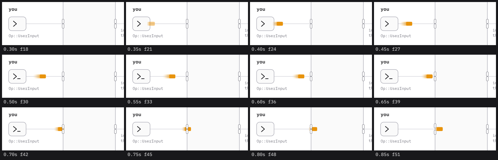
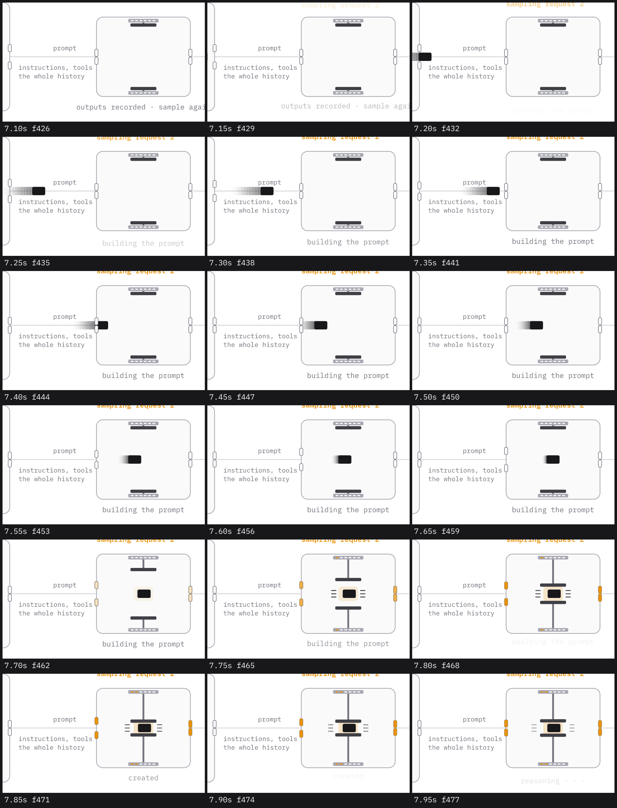
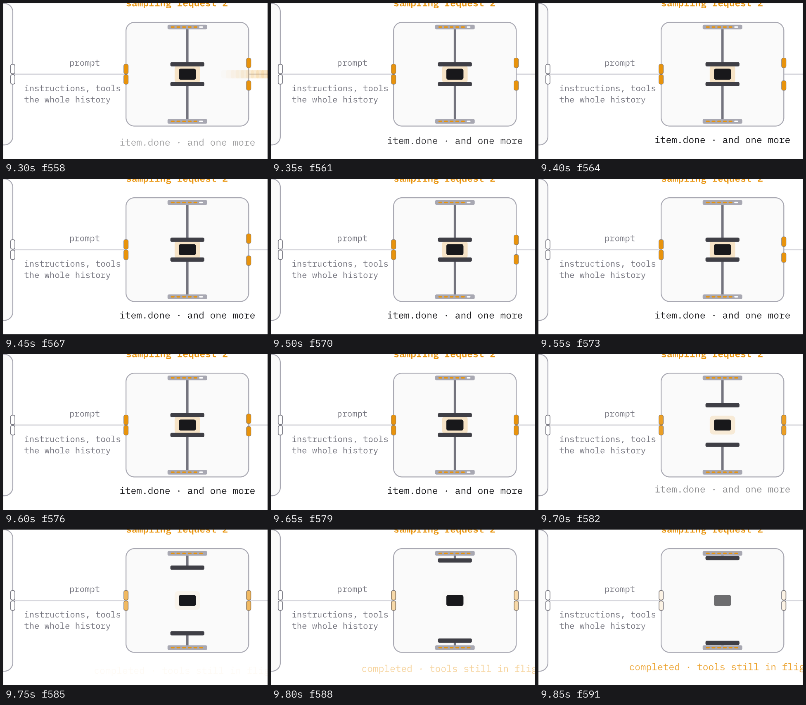
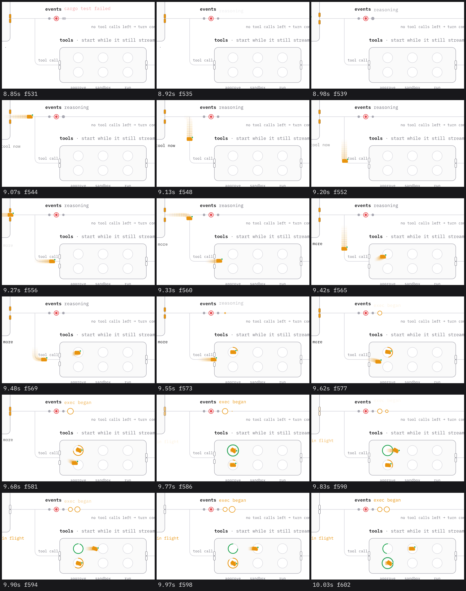
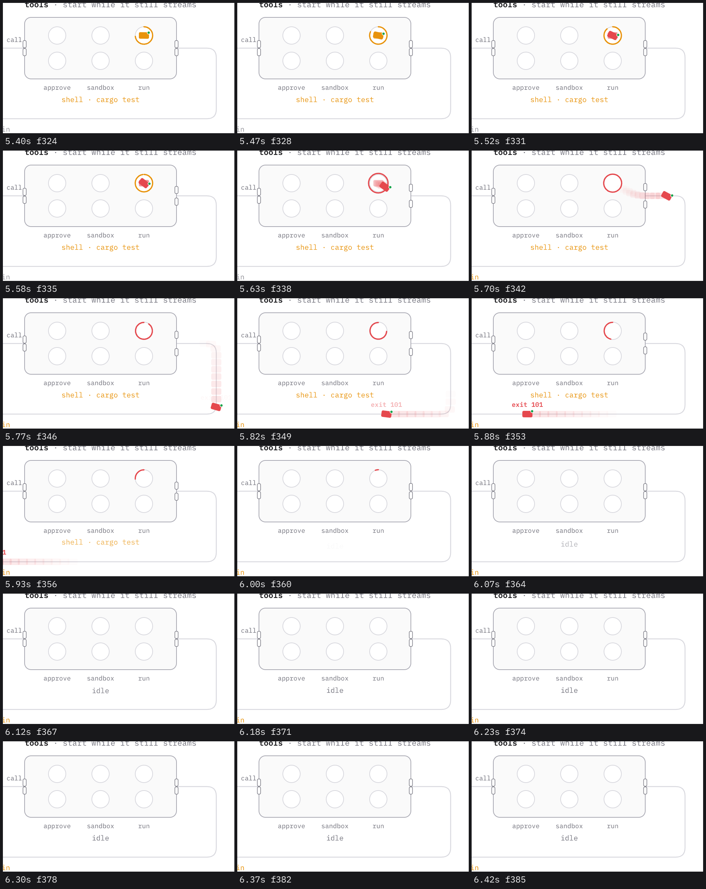
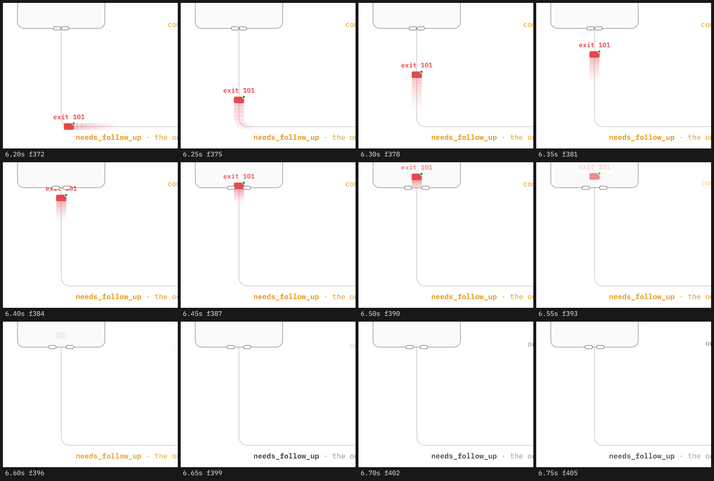
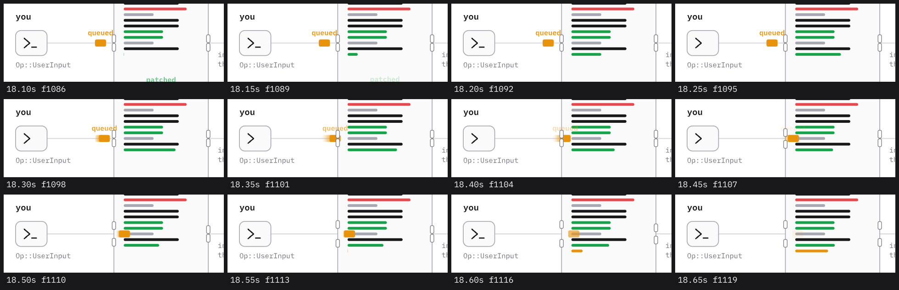
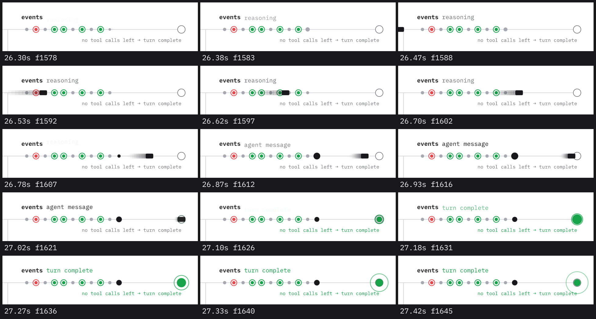

# The motion, mechanism by mechanism

Every number here is in `template/lib.rs`. Every strip in `../images/` is consecutive frames
of the accepted video, cropped and zoomed, each cell labelled with its second and frame. A new
video must produce the same strips (commands in SKILL.md, step 5). Change a number only when
a strip shows the reason.

## Springs

All motion is `fframes::animation::SpringRuntime`
(`SpringRuntime::new(mass, stiffness, damping).solve(&seconds)` goes 0 → 1). The only other
curve is `smooth`, a smoothstep, for opacity.

| name | definition | used for |
| --- | --- | --- |
| travel | `throw(seconds, 0.78)` | every move of a card |
| pop | `SpringRuntime::new(1.0, 260.0, 11.0)` (damping ratio 0.34, two visible swings) | history bars, event dots, ring pops, the terminal |
| clamp | `SpringRuntime::new(1.0, 420.0, 30.0)` (ratio 0.73, closes in about 0.15 s) | the press plates |

```rust
/// A spring that first reaches its target after `seconds`.
fn throw(seconds: f32, damping_ratio: f32) -> SpringRuntime {
    let damped = (1.0 - damping_ratio * damping_ratio).sqrt();
    let frequency = (std::f32::consts::PI - (damped / damping_ratio).atan()) / (damped * seconds);
    SpringRuntime::new(1.0, frequency * frequency, 2.0 * damping_ratio * frequency)
}
```

`throw` lets the schedule say "arrives 0.55 s after it leaves" while the motion is a real
spring: a fast launch, a visible deceleration, about 2% overshoot. A route continues straight
past its end (`Route::at` with `u > 1`, at most 160 px of route length counted), so the
overshoot is real movement.

Do not lower the ratio. With 0.42-0.6 on every move the cards wobbled at each stop and the
long return drifted for two seconds; that version was rejected.

## Cards

| property | value |
| --- | --- |
| shape | rounded rectangle, height 0.64 of the width, radius 4. Never a circle |
| smear | 10 ghosts at the card's positions of 6, 12, … 60 ms ago, opacity `0.16 * (1 - i / 11)`, drawn under the card. They follow the real path, so the smear bends around corners and is gone at rest |
| badge | on tool calls: green dot radius 4 with a 1.5 px white stroke on the top right corner |
| appear | opacity 0 → 1 in 0.1 s at departure, inside or at the edge of the machine it leaves |
| disappear | opacity 1 → 0 in 0.12 s at `dies`, inside the machine that takes it |
| lean | 38° clockwise, rising during the 0.22 s before it leaves a slot, falling during 0.3 s after |
| color | `fills`: a tool call is amber and turns green or red 0.12 s before it leaves the last slot |
| tag | 18 px weight 600 text in the card's color, 20 px above its center, between two times, fading with `window` |

Sizes: 28 px wide for input, calls, outputs and the message; 36 px for the prompt; 18 px for
reasoning.

## Gate: a card enters a machine



- 0.30 s: the card fades in at the edge of the "you" box. 0.35-0.65 s: it moves with a smear
  that is longest at the start and shrinks as it slows.
- 0.70 s: at the wall. The two halves of the gate have moved apart (centers from 11 px to
  24 px off the rail) and the card is between them. 0.85 s: inside; the gate is closing.
- The caret after the prompt mark blinks at 2 Hz the whole time.

Numbers: openness is `window(t, crossing - 0.16, crossing + 0.1)`, where `window` rises in
0.15 s and falls in 0.25 s. `fn leg` computes `crossing` from the spring
(`reach(&spring, fraction)`), so no gate time is written by hand. Gates are drawn above
cards. A gate on a top or bottom wall lies flat (20 x 9 px halves).

## Press: the model takes the prompt



- 7.15 s: the request counter above the machine rises 8 px and fades in over 0.2 s; the
  status line swaps to "building the prompt".
- 7.20-7.60 s: the prompt card (ink, 36 px) leaves the history gate, crosses, passes the model
  gate (open at 7.40 s) and settles in the center.
- 7.65 s (`PROMPT_SENT` = 0.55 s into the request): the plates leave the walls on their stems.
  7.75 s: they are on the card, three short lines fly off each side, the side gates turn
  amber, an amber glow sits behind the card.
- 7.80 s: the plates may overlap the card by a few pixels for one or two frames, then rest
  just outside it. 7.85-7.95 s: the first lights on both mounts are amber, the status line
  says "created", then "reasoning · · ·".

Geometry, relative to the center of the 260 x 220 machine:

| part | value |
| --- | --- |
| mounts | 84 x 10 px bars at ±100 px, edge color, each with six 8 x 3 px lights, 12 px apart, white until lit amber |
| plates | 72 x 9 px, `#3f3f46`, resting at ±88 px, clamped at ±21 px |
| stems | 5 px lines from mount to plate |
| glow | 54 x 40 px amber rectangle behind the card, opacity 0.22 times the clamp |
| sparks | three 12 px lines per side, 9 px apart, moving from 34 px to 56 px from the center and fading over 0.4 s, starting 0.08 s after the clamp |

`closed = sprung(clamp, t - clamps) - sprung(clamp, t - completes)`. The six lights turn on at
`CREATED`, `REASONING`, `REASONING_DONE`, `ITEM_STARTS`, `ITEM_DONE` and at completion.

## Press: the response completes



- 9.30 s: a tool call has just left through the right gate (its smear is still at the edge),
  all lights but the last are on, the status line is "item.done · and one more".
- 9.65 s: the last light turns on (completion of request 2 is at 9.65 s). 9.70-9.80 s: the
  plates go back to the walls, the glow fades, the gates lose their amber.
- 9.85 s: the prompt card is fading out in place, the status line is "completed · tools still
  in flight" in amber. The lights go out 0.5 s after completion.

## Slots: tool calls arrive



- 8.92-8.98 s: a reasoning dot pops onto the event rail (grey, overshoots its size once).
- 9.07-9.20 s: the first call (amber, green badge) leaves the model gate, turns down the
  branch with its smear bending around the corner.
- 9.27-9.42 s: it passes the tools gate (open) and goes up into the first slot of lane 1,
  while the second call, 0.25 s behind, is at the model gate.
- 9.48-9.62 s: an amber arc grows around the first card; an amber ring pops onto the event
  rail and the events line says "exec began"; the second call lands in lane 2.
- 9.68-9.83 s: the first ring is full, turns green and pops; the card leans 38° and leaves
  toward "sandbox". 9.90-10.03 s: the green ring unwinds behind it, the second call's ring
  fills, a second amber ring is on the event rail.

Ring numbers: radius 24, stroke 3.5 px with round caps, grows clockwise from the top as
`progress * 360°` over the whole stay; when full it takes the result color and its radius pops
by 14% with the pop spring; from 0.1 s to 0.45 s after the end it unwinds from its start. An
arc is never drawn at 0° (`fn arc` clamps to 0.5°).

## Slots: a call ends and its output leaves



- 5.40-5.52 s: the card sits in "run" with a nearly full amber ring; it turns red (0.12 s
  before the end) and starts to lean.
- 5.58-5.63 s (`TOOL_DONE` at 5.60 s): the ring is full, turns red and pops; the card leaves.
- 5.70-5.88 s: through the right gate (open), down and around the corner; "exit 101" fades in
  above it once it is on the bottom rail; the label of the return rail turns amber.
- 5.93-6.07 s: the red ring unwinds to nothing; the status line under the machine swaps from
  the call's name to "idle".

## Stack: the output is recorded



- 6.20-6.35 s: the card turns the last corner and goes up, its tag above it.
- 6.40-6.50 s: the flat bottom gate opens and the card passes between its halves.
- 6.55-6.60 s (`OUTPUT_RECORDED` at 6.50 s): the card fades out inside the box. A red bar
  springs into the history at the same moment, and the return label goes back to grey.

Bars: width `target * pop.solve(t - at)`, so a new bar overshoots its length once. A bar is
not drawn at all before its time (a 0.5 px bar at full opacity shows as a speck).

## Queue: a message waits and is let in



- 18.10-18.25 s: the amber card rests just outside the history gate (x 286) with "queued"
  above it; inside, the green bar of the patch output springs in.
- 18.30-18.45 s (drained at 18.25 s): the card moves, the gate opens, the tag fades.
- 18.50-18.65 s: the card is inside and fades; an amber bar for your message springs in at
  the end of the stack.

The queued card is one `Card` with two legs: to the waiting point at `sent`, into the machine
at `drained`. Its row in the band below is lit for the whole wait.

## Event rail and the ending



- 26.30-26.38 s: a reasoning dot pops on. The rail already holds, in order: grey dot, red
  ring, grey, two green rings, grey, green ring, grey, green ring.
- 26.47-26.93 s: the message card (ink) crosses the whole rail in 0.7 s with a long smear; at
  26.78 s its dot (ink, radius 10) pops on and the events line says "agent message".
- 27.02 s (`DONE_AT` = 27.0 s): the card is on the terminal. 27.10-27.18 s: the terminal fills
  green with the pop spring, the events line swaps to "turn complete" in green, the sentence
  under the rail turns green.
- 27.27-27.42 s: one ring grows from the terminal (radius 14 → 64 px) and fades over 0.8 s.

Dots: radius times the pop spring. A call is a ring that is amber while it runs and takes
the result color when it ends, with a filled center that pops in.

## Status lines

`fn note(notes, t, x, y, size, anchor)`: on a change the old text moves up 16 px and is gone
in 0.1 s; the new text starts 14 px low at opacity 0, becomes visible between 0.08 s and
0.24 s and is in place at 0.26 s. Two texts are never readable at once (see the last row of
the press strips). Colors per entry: grey for a stage in progress, ink for an event that just
happened, amber for "still waiting on something", green or red for a result.

## What lights up

- The return rail's label: amber while an output is on the rail.
- The band's row: amber while its event happens (the queued message).
- The context bar: grows with the recorded items (`0.7 * 300 px` when all are in), with an
  amber tick at the limit.
- The corner clock: one turn per loop.

## Order of drawing

Background, static backdrop (rails, boxes, static labels), history bars, press, status lines,
event dots and terminal, slots, cards, gates, the band below. Cards are above machines and
below gates.

## What each strip must show

Go through this list with the new video's strips next to the originals.

1. A moving card has a smear that is longest right after it starts; a resting card has none.
2. A gate is open in the frames where the card is on the wall and closed again within 0.25 s.
3. The plates stop on the card; after two frames they do not overlap it.
4. Sparks exist for 0.4 s only, right after the clamp.
5. A ring is full before it changes color, pops once, and unwinds while the card leaves.
6. A card leans before it leaves a slot and is level again 0.3 s later.
7. A tag appears only after the card is out of the machine and is readable for most of the
   trip.
8. A new history bar and a new event dot overshoot once.
9. A status line never shows two readable texts.
10. Two cards are in different machines in at least one strip.
11. In the last strip the terminal fills, the green text appears and one ring leaves.
