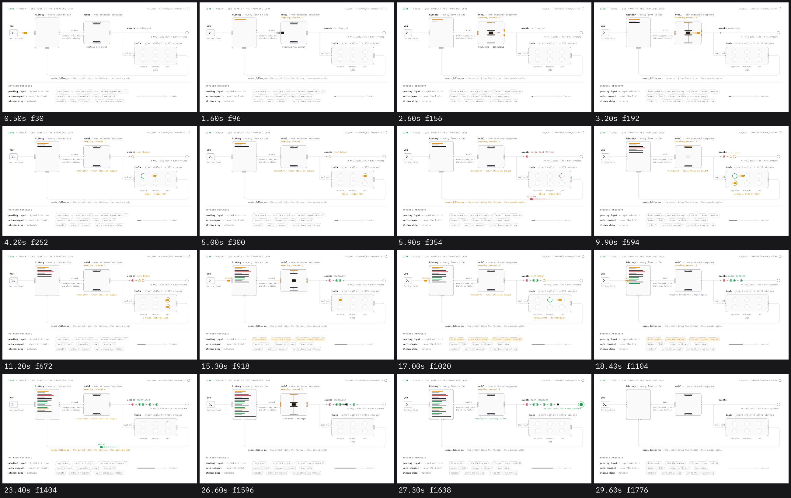

# The timeline of the template

One loop is 29.9 s (1794 frames at 60 fps). All times in seconds. They follow from the
constants in `template/lib.rs`; this file is the result, for checking a frame against what
should be on it.

## Whole loop

| time | what happens |
| --- | --- |
| 0.0 | empty diagram. Status lines: "waiting for input", "nothing yet", "idle" |
| 0.3 | your input card leaves the "you" box |
| 0.95 | it is recorded: first history bar (amber) |
| 1.3 | request 1 starts |
| 7.1 | request 2 starts |
| 12.9 | request 3 starts |
| 13.9 | you type one more message; from 14.35 it waits at the history gate with "queued" |
| 18.25 | the queued message is let in; its bar appears at 18.55 |
| 18.7 | request 4 starts |
| 24.5 | request 5 starts |
| 26.3 | the final message leaves the model |
| 27.0 | it reaches the terminal: "turn complete" |
| 29.0 | everything the turn drew fades in 0.5 s (bars, dots, status lines back to their first text) |
| 29.9 | loop point, same picture as 0.0 |

## Inside a request

Offsets from the start of the request (`S`). Request starts: 1.3, 7.1, 12.9, 18.7, 24.5.

| offset | event | on screen |
| --- | --- | --- |
| 0.00 | the prompt card leaves the history | counter "sampling request N" rises in; model line "building the prompt" |
| 0.55 | it is in the model | press closes, sparks, gates amber |
| 0.62 | `created` | light 1; model line "created" |
| 0.72 | reasoning deltas | light 2; "reasoning · · ·" |
| 1.20 | reasoning item done | light 3; "item.done · reasoning"; grey bar in the history; a small grey card leaves for the event rail |
| 1.30 | next item starts | light 4; "function_call · · ·" (last request: "message · · ·") |
| 1.70 | the reasoning dot is on the event rail | events line "reasoning" |
| 1.80 | `item.done`, call 1 | light 5; "item.done · start the tool now"; ink bar in the history; the call card leaves the model |
| 2.05 | `item.done`, call 2 (request 2 only) | "item.done · and one more"; second call card leaves |
| 2.30 | `completed` (2.55 with two calls) | light 6; press opens; "completed · tools still in flight" in amber |
| 2.40 | call 1 lands in "approve" (call 2 at 2.65) | amber ring on the event rail; events line "exec began"; tools line shows the call |
| 2.65 | approval ends (3.30 for `apply_patch`) | ring green, card leans, hops 0.3 s to "sandbox" |
| 2.95-3.25 | in "sandbox" (3.60-3.90 for `apply_patch`) | ring fills |
| 3.55 | lands in "run" (4.20 for `apply_patch`) | ring fills until 4.30 |
| 4.30 | the tool ends (4.55 for call 2) | ring takes the result color; the card, already in that color, leaves; the event ring fills; events line names the result |
| 4.60 | | tools line back to "idle" |
| 5.20 | the output is recorded (5.45 for call 2) | bar in the history in the result color; model line "outputs recorded · sample again" |
| 5.80 | the next request starts | |

The last request has no call: at 1.80 the message card leaves ("item.done · message"), at
2.20 its dot is on the rail ("agent message"), at 2.30 the press opens ("completed · nothing
to run", green), at 2.50 it reaches the terminal ("turn complete", green).

## What each request carries

| request | tools line | tag on the output | events line at the end | bar |
| --- | --- | --- | --- | --- |
| 1 | `shell · cargo test` | `exit 101` | `cargo test failed` (red) | red, 160 px |
| 2 | `2 calls, side by side` | `3 matches`, `41 lines` | `rg ended`, `sed ended` (green) | two green, 100 px |
| 3 | `apply_patch · waits for you`, then `apply_patch · src/range.rs` | `patched` | `patch applied` (green) | green |
| 4 | `shell · cargo test` | `exit 0` | `tests pass` (green) | green |
| 5 | `idle` | none | `turn complete` (green) | ink, 190 px |

At the end the history holds 18 bars and the event rail 11 dots.
